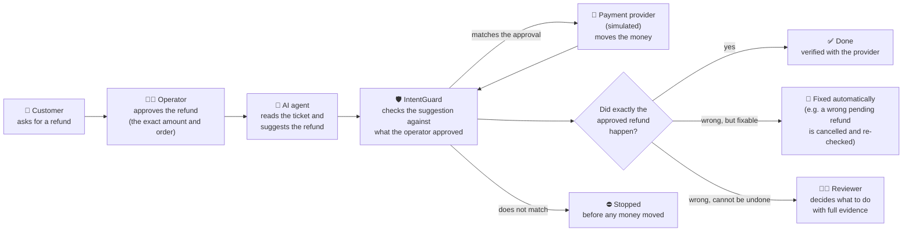
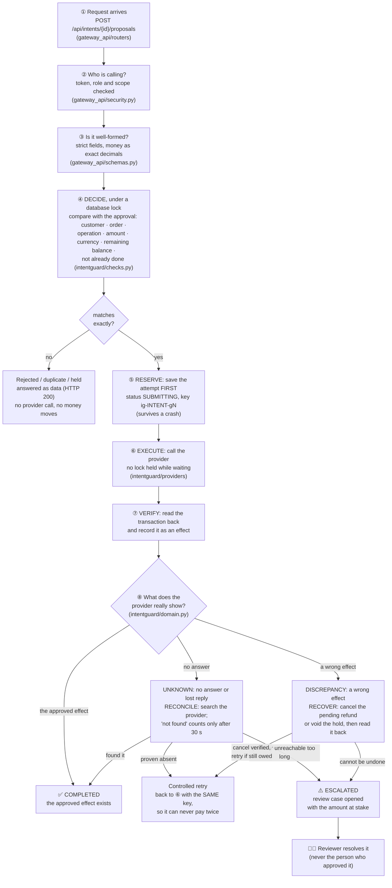

# IntentGuard — the big picture

A plain-language overview of what IntentGuard does, how a refund travels through it, and what is
in each folder. For setup steps see [README.md](README.md); for the detailed specs see
[docs/README.md](docs/README.md).

> IntentGuard is a research prototype. It only ever talks to a **simulated** payment provider with
> made-up customers, orders and money. No real money moves.

---

## 1. The problem in one paragraph

Companies are starting to let AI assistants handle support tickets, including refunds. The AI can
make mistakes:
- it can refund ten times too much;
- it can pick the wrong order;
- it can send the same refund twice after a crash.

A payment system can also be unreliable: it can time out after the money has already moved, or pay
the wrong amount. IntentGuard sits between the AI and the payment system. It makes sure only what a
human approved can happen, that it happens **once**, and that every result is checked with the
payment provider before anyone is told "done".

---

## 2. Horizontal architecture — the flow anyone can follow

Read it left to right. Each box is a person or a system; each arrow is something handed over.



In words:

1. A **customer** asks for a refund.
2. An **operator** (a person in support or finance) approves it: this customer, this order, this exact amount.
3. The **AI agent** reads the ticket and suggests the refund. It cannot move money itself.
4. **IntentGuard** compares the suggestion with the approval. If anything differs (amount, order, customer, currency), it stops the request here: **no money moves**.
5. If it matches, IntentGuard asks the **payment provider** to make the refund, once, with a key that prevents doubles.
6. IntentGuard then **asks the provider what really happened**, rather than trusting the reply:
   - **Exactly as approved:** marked **done**.
   - **Wrong but reversible** (for example a wrong refund still pending): IntentGuard cancels it and checks the cancellation worked.
   - **Wrong and not reversible:** a **reviewer** gets the case, with the amount at stake and all the evidence.

Everything along the way is written to a tamper-evident **audit log**.

### Who does what

| Person / system | Their part | In the dashboard |
|---|---|---|
| **Operator** | Approves refunds, follows them, chases stuck ones | Overview, Intents, Exceptions |
| **Reviewer** | Resolves cases that went wrong; checks the audit log is intact | Review queue, Reconciliation, Audit |
| **Admin** | Manages users, AI-agent access, safety policies, provider settings | Admin page |
| **AI agent** | Suggests refunds; nothing else | Not a dashboard user: it gets a short-lived key for one approval |
| **Payment provider** | Actually moves money (here: a simulator) | — |

One rule matters most: **the person who approved a refund cannot also sign off on its problems.**
A different reviewer or admin must do that.

---

## 3. Vertical architecture — the technical flow

Read it top to bottom. This is what happens inside the gateway for one proposal, with the file that
does each step.



Running alongside every step:
- **Background worker:** re-checks anything still unknown or pending, every few seconds.
- **Signed webhooks:** status messages from the provider are verified, de-duplicated, then re-checked with the provider before they count.
- **Investigator:** for stuck cases it suggests one action; a fixed policy gate decides whether that action is allowed.
- **Audit log:** every step above is written down, hash-chained and append-only.
- **Database:** stores all of it. It is a single SQLite file locally, and PostgreSQL in Docker.

The rules that make this safe:

| Rule | Why |
|---|---|
| **The agent never talks to the provider.** Only the engine does. | A confused or tricked AI cannot move money directly. |
| **Save before you call.** The attempt is written to the database before the provider call. | If the server crashes mid-call, it knows on restart that a call may have happened, and checks. |
| **One key per approval** (`ig-<intent>-g<generation>`). | Restarts, retries and two agents at once all reuse the same key, so the provider makes the refund only once. |
| **A timeout is "unknown", not "failed".** | The money may already have moved; retrying blindly would pay twice. |
| **"Not found" only counts after a waiting period.** | Provider search can lag behind reality. |
| **Only the provider's own records decide the outcome.** | A "success" reply, or the AI's memory, is not proof. |
| **The audit log can only grow.** Each entry is chained to the previous one by a hash. | Any later edit is detectable. |

---

## 4. External and internal workflow

### External workflow — what people and outside systems do

1. **Admin** sets things up: user accounts and roles, safety policies (maximum amount, kill switch), and the provider connection. When an AI agent needs access, the admin issues it a short-lived key for one approval.
2. **Operator** signs in and creates an **authorization**: customer, order, operation (refund or payment hold), exact amount, currency, and optionally the support ticket text.
3. **AI agent** submits a **proposal** for that authorization: either by calling the API with its key, or when the operator presses "Run agent on the ticket".
4. **Payment provider** receives a request from IntentGuard, never from the agent. It replies, and later sends **signed webhooks** when a status changes.
5. **Reviewer** works the review queue. Each case shows what happened, the amount at stake, and an optional AI suggestion. The reviewer picks one resolution:
   - accepted as is;
   - refund recovered outside the system;
   - written off;
   - confirmed no effect;
   - other.

   The reviewer also runs reconciliation checks and verifies the audit log.
6. **Anyone with access** can watch progress live: every intent has a timeline and a five-step pipeline (Authorized → Proposed → Validated → Executing → Outcome).

### Internal workflow — what IntentGuard does on its own

1. **Check** the proposal against the authorization and the order's remaining balance.
2. **Reserve** an attempt in the database (crash-safe), with the one-per-approval key.
3. **Call** the provider, without holding a database lock.
4. **Read back** what the provider recorded, and store it as an **effect**.
5. **Work out the state** from the evidence: completed, unknown, discrepancy, and so on.
6. **Keep going in the background.** A worker inside the gateway re-checks anything unknown or pending:
   - it reconciles unknown outcomes;
   - it retries safely when absence is proven;
   - it cancels and verifies wrong pending effects;
   - it escalates what it cannot fix.
7. **Listen to the provider.** Webhooks are verified and de-duplicated, but used only as a hint: IntentGuard always re-asks the provider.
8. **Compare everything on request.** A reconciliation run checks the database and the provider for missing, duplicate or mismatched transactions. It only reports; it never changes anything.
9. **Write everything down** in the append-only, hash-chained audit log.

### The four things IntentGuard keeps apart

| Word | Means | Example |
|---|---|---|
| **Intent** | What the human approved | "Refund ₹1,500 on ORD-204 to C-17" (`INT-1001`) |
| **Proposal** | What the AI asked for (may be wrong) | "Refund ₹15,000 on ORD-204" → rejected (`PRP-1`) |
| **Attempt** | One call IntentGuard made to the provider | `ATT-001` with key `ig-INT-1001-g0` |
| **Effect** | What the provider actually did | refund `rf_…` of ₹1,500, completed (`EFF-1`) |

Keeping these separate is what lets IntentGuard say "the AI asked for the wrong thing, nothing
moved", or "the call timed out, but the refund exists, so don't pay again".

---

## 5. What is in each folder

```
IntentGuard_Documentation/
├── start.bat / stop.bat     one-click start and stop on Windows
├── OVERVIEW.md              this page
├── README.md                setup, quick start, headline result
├── docker-compose.yml       optional: run everything in containers (with PostgreSQL)
├── Makefile                 shortcuts: make test, make run-gateway, make bench-quick, ...
├── .env.example             settings template; start.bat copies it to .env and adds secrets
│
├── backend/                 everything in Python
│   ├── intentguard/         THE CORE: the safety protocol itself
│   │   ├── domain.py          states, decisions, legal state changes (TRANSITIONS)
│   │   ├── checks.py          the yes/no checks a proposal must pass
│   │   ├── engine.py          decide → reserve → execute → verify → reconcile → recover
│   │   ├── models.py, db.py   database tables and rules the database enforces
│   │   ├── audit.py           the hash-chained audit log
│   │   ├── money.py           exact money handling (no rounding)
│   │   ├── providers/         how the engine talks to a payment provider (HTTP or in-process)
│   │   └── agents/            turning ticket text into a proposal (rules, or an LLM)
│   ├── gateway_api/         the web server on :8000 (FastAPI)
│   │   ├── routers/           the API endpoints: auth, intents, recovery, reviews, admin, ...
│   │   ├── security.py        login, tokens, roles and permissions
│   │   ├── webhooks.py        receiving signed provider events
│   │   ├── reconciliation.py  reconciliation runs and mismatch detection
│   │   └── seed.py            demo users and orders
│   ├── investigator/        the advisory AI for unclear cases + the policy gate that limits it
│   ├── paysim/              the PAYMENT SIMULATOR: fake refunds, holds, delays and injectable faults
│   ├── provider_api/        the simulator's web server on :8001 (+ webhook sender)
│   ├── tests/               127 automated tests (also run against PostgreSQL in CI)
│   └── requirements.txt     Python packages
│
├── frontend/                the dashboard on :3000 (React + Vite)
│   └── src/
│       ├── pages/             Login, Overview, Intents, Intent detail, Exceptions, Review queue,
│       │                      Reconciliation, Audit, Experiments, Admin
│       ├── components/        pipeline, timeline, status pills, demo scenario cards, panels
│       ├── api/               the only place that calls the backend (one route table)
│       ├── hooks/             login session, auto-refresh
│       └── styles/            colours, fonts and layout (dark and light themes)
│
├── experiments/             the research benchmark
│   ├── bench/                 scenario generator, AI error model, the 15 compared designs,
│   │                          scoring against the provider's real ledger
│   └── results/latest/        the measured results that every document quotes
│
├── docs/                    documentation
│   ├── PRD, FEATURES, ARCHITECTURE, API, DESIGN, SECURITY, TEST_PLAN, DECISIONS
│   │                          the target design, each marked built / planned
│   ├── architecture/, operations/, product/, security/, testing/
│   │                          how the code works today, and how to run and demo it
│   ├── research/              method, results, limitations, paper draft
│   ├── diagrams/              architecture and state diagrams
│   ├── api/openapi.json       machine-readable API description
│   └── archive/               old prototype documents (history only)
│
├── scripts/                 helpers: start/stop, create .env, back up an old database,
│                            export the API schema, benchmark safety check
└── .github/workflows/ci.yml the automatic checks run on every push
```

---

## 6. Where to go next

| I want to… | Read |
|---|---|
| run it and click through the demo | [docs/operations/running.md](docs/operations/running.md), [docs/operations/demo.md](docs/operations/demo.md) |
| understand every state and transition | [docs/architecture/state-machine.md](docs/architecture/state-machine.md) |
| see every API endpoint | [docs/API.md](docs/API.md) |
| know what is built and what is planned | [docs/FEATURES.md](docs/FEATURES.md) |
| see the research results | [docs/research/results.md](docs/research/results.md) |
